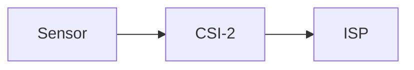

# sysdev.me post formatting

What a post may contain and how each thing renders. Posts are plain Markdown in `src/content/posts/en/<slug>.md` and publish at `/YYYY/MM/DD/<slug>/`.

## Front matter

```yaml
---
title: "Post title"
description: "One or two sentences."
date: 2026-10-19
slug: "post-url-segment"
lang: en
category: cpp
tags: ["C++", "Tooling"]
cover: "/img/post-url-segment/lead.jpg"
featured: false
---
```

| Field         | Renders as                                                                                                                                                            |
| ------------- | --------------------------------------------------------------------------------------------------------------------------------------------------------------------- |
| `title`       | Page `<h1>`, tab title, card title, social card.                                                                                                                      |
| `description` | Lead paragraph under the byline, card excerpt, meta description, social-card text. Required, non-empty.                                                               |
| `date`        | Byline date, feed order, and the `/YYYY/MM/DD/` path.                                                                                                                 |
| `slug`        | The URL segment; overrides the filename. Lowercase, hyphens, no slashes or spaces.                                                                                    |
| `lang`        | `en`. The only language the site builds.                                                                                                                              |
| `category`    | The chip above the title and the sidebar icon. One of: `tooling`, `cpp`, `ai`, `go`, `rust`, `industry-analysis`, `books-and-articles`, `python`, `gstreamer`, `git`. |
| `tags`        | Chips at the foot of the post, free text, each filterable.                                                                                                            |
| `cover`       | Card image and the photo behind the social card — normally the lead photo. Without it, cards collapse to text.                                                        |
| `featured`    | `true` pins a "Featured" badge on the card. Does not reorder anything.                                                                                                |
| `updated`     | Optional. Sitemap `lastmod` and `date_modified` in the JSON feeds.                                                                                                    |
| `draft`       | `true` removes the post from the build entirely.                                                                                                                      |

Reading time is computed from the body at 200 words per minute; code fences and HTML tags are excluded.

## Lead image

Every post opens with a nature photo — a mountain, a lake, a gorge — floated left of the first paragraphs, with a caption under it. Raw HTML, immediately after the front matter:

```html
<figure style="float: left; width: 300px; margin: 0 1em 1em 0;">
  <a href="/img/<slug>/photo.jpg" target="_blank">
    /photo.jpg" alt="" width="250" />
  </a>
  <figcaption>Place name. One line tying it to the article.</figcaption>
</figure>
```

Below 760px the float drops and the photo becomes a centred block at full width. Images live in `public/img/<slug>/` and are referenced from the site root as `/img/<slug>/…`.

## Body syntax

| Write                                | Renders as                                                                                                      |
| ------------------------------------ | --------------------------------------------------------------------------------------------------------------- |
| `## …` / `### …`                     | Section headings. Both get anchor ids and appear in the "On this page" sidebar; `####` and deeper do not.       |
| `**bold**`, `_italic_`, `~~strike~~` | Standard marks. Quotes, dashes and ellipses become typographic.                                                 |
| `` `code` ``                         | Inline code on a tinted background.                                                                             |
| Fenced code                          | Syntax-highlighted by Shiki, with a copy button in the corner. An unknown language id falls back to plain text. |
| Tables, lists, task lists            | GitHub-flavoured Markdown, all supported.                                                                       |
| `> quote`                            | Muted text behind a left rule.                                                                                  |
| `[^1]` + `[^1]: …`                   | Bracketed superscript marker; notes collected at the foot of the post with a link back.                         |
| `---`                                | A horizontal rule.                                                                                              |
| Raw HTML                             | Passed through verbatim — how the lead figure works.                                                            |

## Callouts

A `:::` block renders as a collapsible box. Five kinds, each with its own colour and icon: `note` (pencil), `example` (flask), `info`, `tip` (flame), `warning` (triangle).

````markdown
:::example[Simple echo server source code]
Ordinary Markdown, including fenced code, tables and Mermaid diagrams.

```go
func main() {}
```

:::
````

The label in brackets is optional and falls back to the kind's name. `{open}` after it renders the box expanded instead of collapsed:

```markdown
:::note[Why this matters]{open}
Visible without a click.
:::
```

A link into a collapsed callout — a sidebar heading, a footnote, a shared anchor — opens it automatically.

## Diagrams

```html
/pipeline.svg" width="1024" alt="" />
```

````markdown

````

A pre-rendered SVG is static and travels into the RSS and JSON feeds. A Mermaid fence renders in the browser, follows the light/dark toggle, and does not appear in the feeds. Use `width="640"` for a narrow diagram.

## What fails the build

- A missing or empty `title` or `description`.
- A `category` outside the ten listed, or a `slug` with a capital, space or slash.
- A misspelled callout kind — `:::warn` stops the build and names the file and line.
- A `cover` pointing at a file that is not in `public/`.

`pnpm build` checks all of it before anything reaches `dist/`.
